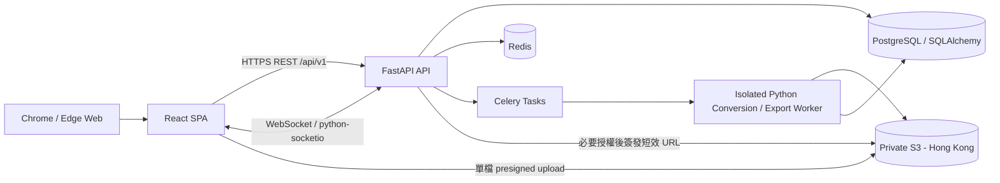

# My Deck 開發技術棧方案

- 文件版本：V0.4
- 文件狀態：Python 後端、前端 Vite 與 lint 方向已由使用者確認；其餘供應商與部署細節待確認
- 更新日期：2026-11-17
- 需求基準：`docs/requirements.md` V0.19
- MVP 基準：`docs/mvp-priority.md` V0.3
- 權限基準：`docs/permissions.md` V0.8

## 1. 方案目標與原則

本方案同時支援兩個交付層次：

1. **6 天 MVP**：優先完成登入／註冊、課程展示、單檔課件上傳與靜態預覽、個人文字標註的最小閉環。
2. **完整產品**：在不推翻 MVP 架構的前提下，加入即時課堂、共享標註、簽到、答題、統計、課後匯出與刪除。

已確認的技術方向：

- 前端維持 **React + Mantine + TypeScript**，由 **Vite** 提供開發伺服器與正式建置。
- 前端靜態品質檢查採 **ESLint + Prettier + Stylelint**，配合 TypeScript strict，不使用警告豁免代替修正。
- 後端及背景 worker 改用 **Python + FastAPI**。
- 前後端以 **OpenAPI／JSON Schema** 作契約，不再假設可直接共用 TypeScript 程式碼。

其他取捨原則：

- **模組化單體優先**，只把不可信 PPT 轉換及背景匯出拆成獨立 worker 進程／容器。
- **PostgreSQL 是業務事實來源**；Redis 不作為課堂、標註或答案的唯一保存位置。
- **原檔、WebP 及匯出檔使用私有物件儲存**，不直接把檔案塞入資料庫。
- **瀏覽器採可撤銷工作階段 Cookie**，不把密碼、登入 token 或課堂私密內容放入 localStorage。
- MVP 不引入微服務、Kubernetes、CRDT 或非必要的 SSR。

## 2. 推薦技術總表

| 層次 | 本期採用 | 用途與理由 |
|---|---|---|
| 前端語言 | TypeScript | React 介面、型別安全及生成 API client |
| 後端語言 | Python，鎖定受支援穩定版本 | 使用者已確認；適合 FastAPI、PPT、圖片及資料處理 |
| Web 套件管理 | pnpm | 管理 React SPA 與前端工具 |
| Python 套件管理 | uv + lockfile | 鎖定 API、worker 及共用 Python 套件版本 |
| Web | React + **Vite** + TypeScript | SPA 開發伺服器、HMR、正式打包與預覽；`tsc` 負責型別檢查，不能只依賴 Vite 轉譯 |
| UI | Mantine | 已確認方案；統一覆寫主題、間距、圓角、元件尺寸及狀態 |
| 路由 | React Router | 對應 PG-001～PG-020 獨立頁面及受保護路由 |
| 服務端資料狀態 | TanStack Query | 處理查詢、3 秒輪詢、重試、失效刷新及提交後更新 |
| 表單 | React Hook Form；Zod 用於必要的前端體驗校驗 | 前端即時回饋；最終校驗由 FastAPI／Pydantic 執行 |
| 前後端契約 | FastAPI OpenAPI + `openapi-typescript`／`openapi-fetch` | 由後端 schema 生成 TypeScript 型別，避免手寫兩套 REST 契約 |
| 密碼強度 | 前端 JS `zxcvbn` + 後端兼容 Python 實作 | 至少 3 分；鎖定算法兼容版本、字典及參數，以共同樣本驗證，服務端最終判定 |
| API 框架 | **FastAPI** | 模組化路由、dependency injection、Pydantic 校驗及自動 OpenAPI |
| ASGI 運行 | **Uvicorn** | 同源支援 REST 與 ASGI 即時通道；初期單實例起步 |
| API 風格 | REST `/api/v1` + OpenAPI | 易於除錯、產生文件及供非即時操作使用 |
| 即時通道 | **python-socketio + ASGI**，優先 WebSocket transport | 課堂房間、翻頁、共享標註及活動事件；重連以快照校正 |
| ORM | **SQLAlchemy 2** | 明確 transaction、關聯、查詢及資料庫 constraint |
| Migration | **Alembic** | 可審核、可重現的 PostgreSQL schema 變更 |
| 主資料庫 | PostgreSQL | 帳號、課程、課件版本、課堂、標註、活動及工作階段 |
| Redis | Redis 7+ | Celery broker、短期限流及登入鎖定；不保存唯一業務事實 |
| 背景隊列 | **Celery + Celery Beat** | PPT 轉換、匯出及到期清理；使用明確 task／attempt ID 保證冪等 |
| 物件儲存 | AWS S3 `ap-east-1` 或其他香港 S3 相容儲存 | 私有保存原檔、WebP、縮圖及獨立匯出檔 |
| PPT 轉 PDF | LibreOffice headless，隔離容器 | 將不可信 PPT/PPTX 靜態化；接受已確認的少量相容性偏差 |
| PDF 轉圖片 | pdftoppm／兼容 PDF 渲染器 + **Pillow** | 輸出長邊最高 1920px WebP 及 320px 縮圖 |
| PPTX 匯出 | **python-pptx** | 背景產生新的課堂摘要或本人標註 PPTX |
| 舊式 PPT 匯出 | 先產生 PPTX，再由 LibreOffice 轉 `.ppt` | 不改寫原始課件；失敗不得提供不完整下載 |
| 密碼雜湊 | `argon2-cffi`／Argon2id | 服務端密碼安全保存 |
| 日誌 | structlog JSON + request/task ID | 統一 API、worker 及錯誤追蹤，禁止記錄密碼及驗證碼 |
| 前端測試工具 | Vitest + React Testing Library | 元件、表單及狀態交互 |
| API／整合測試工具 | **pytest + HTTPX + Testcontainers** | 真實 PostgreSQL／Redis 整合驗證 |
| 端到端工具 | Playwright | Edge／Chrome 核心流程與不同角色權限 |
| 容量驗證工具 | k6 | 100 總並發及事件至完成更新的 0–300 ms 驗證 |
| 程式品質 | ESLint + Prettier + Stylelint；**Ruff + mypy** | 前後端格式、型別、品質及 rem 設計規範 |
| CI | GitHub Actions | 安裝、lint、型別檢查、測試、構建及 Docker image 檢查 |
| 本地開發 | Docker Compose | Web、FastAPI、Celery worker、PostgreSQL、Redis、Mailpit 及轉換依賴 |

> 版本政策：Node.js 使用實作時的 Active LTS；Python 使用受支援穩定版。所有依賴由 pnpm／uv lockfile 固定，Docker 基礎映像固定明確版本，不在本文件假裝已安裝或驗證任何版本。

## 3. 總體架構



### 3.1 進程與模組邊界

| 單元 | 職責 | 不負責 |
|---|---|---|
| `web` | 頁面、表單、即時展示、上傳進度及下載 | 最終權限判定、密碼最終評分、檔案信任 |
| `api` | FastAPI 帳號、課程、課件、課堂、標註、活動、權限及快照 | LibreOffice 轉換及大型檔案產生 |
| `worker` | Python Celery 轉換、WebP 輸出、匯出、168 小時清理 | 接收瀏覽器請求或信任用戶端身份 |
| PostgreSQL | 所有業務資料及狀態版本 | 大型二進位檔案 |
| Redis | Celery broker 及短期限制狀態 | 課堂快照、答案或標註的唯一保存 |
| S3 | 私有檔案與圖片資源 | 公開未授權讀取 |

### 3.2 建議 repository 結構

```text
apps/
  web/                  React + Mantine SPA
  api/                  FastAPI routers、dependencies、ASGI 及 OpenAPI
  worker/               Celery 與 Celery Beat 入口
packages/
  server/               共用 Python models、services、policies 及 tasks
  contracts/            OpenAPI、Socket JSON Schema 及生成的 TypeScript 型別
  config/               共用前端 TypeScript、ESLint、Stylelint 設定
infra/
  compose/              本地開發及 MVP 部署設定
  docker/               API、worker、LibreOffice 映像
docs/                   現有需求、拆分、權限及設計文件
```

API 內部按 `auth`、`users`、`courses`、`coursewares`、`classrooms`、`annotations`、`activities`、`exports` 劃分模組。MVP 仍是同一部署單體，不按每個模組拆微服務。

## 4. 前端方案

### 4.1 頁面與資料狀態

- React Router 分為公開帳號頁、老師受保護頁、學生受保護頁及訪客課堂頁。
- TanStack Query 管理課程、課件、標註、活動及摘要等服務端資料。
- 轉換狀態依需求每 **3 秒**查詢；返回詳情立即查詢；查詢失敗保留最後已知狀態並提示。
- 表單草稿及打開的抽屜使用 React 區域狀態；不引入 Redux。
- 所有權限只控制介面呈現，後端必須再次檢查，不能用「隱藏按鈕」代替授權。

### 4.2 Mantine 與 rem 規範

- 在單一主題檔設定品牌色、Noto Sans TC、間距、圓角、元件高度及字體等級。
- 長度使用 rem，`1rem = 16px`；間距、圓角、元件尺寸及字體大小只使用 `0` 或 `0.5rem` 整數倍。
- 線高使用無單位倍率；細邊框固定 `0.0625rem`。
- 以 Stylelint 規則及共用小工具檢查非法單位與非規範增量，避免逐頁覆寫 Mantine。
- SVG 圖示統一使用同一套 icon 元件；不複製 Pear Deck 品牌素材。

### 4.3 上傳與預覽

1. Web 向 FastAPI 申請單檔上傳會話及短效 presigned URL。
2. 以 XHR 直傳私有 S3，顯示真實進度；取消即中止本次請求，重新開始時建立新操作，不實作續傳。
3. API 根據 S3 實際物件位元組及檔案內容重新校驗；通過後才建立待轉換版本及 Celery 工作。
4. 預覽只讀取授權後的 WebP／縮圖 URL，不提供原檔給學生或訪客。

### 4.4 Vite 建置與 lint 規範

**Vite**

- `apps/web` 使用 Vite 的 React + TypeScript 結構；開發採 HMR，正式環境輸出 `dist/`，由同源 Web 入口提供靜態資源。
- 本地開發以 Vite proxy 將 `/api` 及 Socket 路徑轉到 FastAPI；正式環境維持同源，不在程式內散落環境主機字串。
- 瀏覽器環境變數只使用 `VITE_` 公開設定，例如 API 同源路徑；不得把資料庫、S3 或其他秘密放入 `VITE_` 變數。
- Vite 只負責轉譯及打包，不等於型別驗證；每次建置前必須執行 TypeScript 檢查。

**ESLint／Prettier／Stylelint**

- 使用 ESLint flat config，整合 `typescript-eslint`、React Hooks、React Refresh 及 JSX accessibility 規則；TypeScript 啟用 strict。
- Prettier 只負責格式，ESLint 負責程式品質，避免兩者重複規則互相衝突。
- Stylelint 檢查 CSS 與 NFR-013 的 rem 規範；Mantine 主題中的 TS tokens 由共用型別、值檢查工具及程式審查共同約束。
- 忽略 `node_modules/`、`dist/`、`coverage/` 及自動生成契約檔；忽略目錄必須明確，不用全域停用規則掩蓋問題。
- 正常提交不得帶有 lint error 或 warning；例外必須逐行、具原因及有範圍，禁止為了通過檢查而整檔停用規則。

**`apps/web` 預定腳本**

| 指令 | 用途 |
|---|---|
| `pnpm dev` | 啟動 Vite 開發伺服器 |
| `pnpm build` | 先執行 TypeScript 建置檢查，再執行 `vite build` |
| `pnpm preview` | 本地預覽正式建置結果 |
| `pnpm lint` | 執行 ESLint，warnings 視為失敗 |
| `pnpm lint:fix` | 只套用可安全自動修正的 ESLint 規則 |
| `pnpm lint:style` | 執行 Stylelint，包括 rem／非法單位規則 |
| `pnpm typecheck` | 執行 TypeScript 無輸出型別檢查 |
| `pnpm format` | 以 Prettier 格式化受管理的前端檔案 |
| `pnpm format:check` | 只檢查格式，不改寫檔案 |
| `pnpm test` | 執行 Vitest 測試 |

提交前與 CI 依序執行 **lint → Stylelint → typecheck → format:check → test → build**。這些是建立應用程式後必須實作及驗證的腳本，不代表目前尚未建立的 repository 已有這些命令。

## 5. 後端與 API 方案

### 5.1 REST、OpenAPI 與即時事件分工

| 類型 | 通道 | 例子 |
|---|---|---|
| 查詢及表單提交 | REST | 登入、建立課程、上傳完成、保存個人標註、提交答案 |
| 老師控制命令 | REST 或經服務端鑑權的 Socket 命令，統一進入同一 application service | 翻頁、開放活動、結束課堂 |
| 即時狀態廣播 | python-socketio | 當前頁、共享標註、活動狀態及統計更新 |
| 首次進入及重連 | REST／Socket snapshot | 回傳目前課堂快照及最新 `stateVersion` |
| 大型檔案 | S3 + Python 背景 worker | 原檔上傳、WebP、PPT/PPTX 匯出 |

- REST 請求及回應由 Pydantic models 定義，FastAPI 產生 OpenAPI，再生成 TypeScript client 型別。
- WebSocket 事件以 Pydantic 模型匯出 JSON Schema，固定事件名稱、payload 及版本欄位；前端由同一 schema 生成型別或補充必要 runtime 校驗。
- 以 FastAPI dependency／共用 policy 集中執行角色、課程擁有者、課堂參與者、作者及共享授權檢查。
- 所有資料寫入由後端重新驗證；前端生成的型別不代表信任邊界。
- 列表採明確排序及分頁；重試使用 idempotency key 或業務唯一鍵。

### 5.2 即時課堂一致性

1. 每個課堂保存服務端遞增 `stateVersion`、目前 `currentSlideId` 及課堂狀態。
2. 老師命令先完成資料庫 transaction，再廣播帶 `classroomId + stateVersion` 的事件。
3. 用戶端只套用比目前版本新的事件；較舊或重複事件直接忽略。
4. 首次加入、重新整理、斷線重連或發現版本缺口時取得完整快照，不依賴補收所有歷史事件。
5. Socket handshake 使用同一工作階段；加入房間及每個寫入命令都在服務端重新鑑權。
6. 訪客只進入唯讀房間，不接收共享標註層、老師回覆或原檔資源。

**100 總並發的 MVP／初期正式版可由單一 FastAPI／Uvicorn 實例處理。**只有需要多個 API 實例時才加入 python-socketio Redis Manager；不能預先為此引入複雜叢集。CPU 密集的 LibreOffice、Pillow 及匯出工作永遠留在 worker，不佔用 ASGI 進程。

## 6. 資料與儲存方案

### 6.1 PostgreSQL

以現有 ERD 的 19 個實體為基礎，重點包括：

- `users`、`sessions`、`verification_challenges`
- `courses`、`course_members`
- `coursewares`、`slides`、`conversion_attempts`
- `classrooms`、`classroom_participants`、`shared_write_grants`
- `annotation_groups`、`annotations`
- `activities`、`activity_options`、`answer_submissions`、`attendance_records`
- `export_jobs`、`deletion_records`

必須在資料庫層落實：

- 手機、電郵、課程碼及進行中課堂碼的唯一性或必要部分唯一索引。
- 課程成員、簽到及答案的複合唯一鍵，防止重複提交。
- 標註必須關聯課件版本、頁面、課堂及作者；個人／共享可見性由後端查詢條件及 policy 雙重限制。
- 標註位置使用 `0–1` 歸一化座標及 constraint；回覆使用獨立記錄及 self-FK。
- 答案、正確答案及必要匯出中繼資料使用 JSONB，但核心查詢欄位保持結構化。
- 狀態變更使用 SQLAlchemy transaction；過期 attempt 的舊回調不得覆蓋新狀態。
- 所有 schema 變更由 Alembic migration 產生並審核，不在啟動時自動修改正式資料庫。

### 6.2 Redis 與工作階段

- Redis：Celery broker、登入失敗計數、15 分鐘鎖定、課程／課堂碼短期限流。
- PostgreSQL：可撤銷的登入工作階段、最後活動時間、最長到期時間及撤銷時間。
- 登入 Cookie：隨機高熱 opaque token，資料庫只保存其安全摘要；`HttpOnly + Secure + SameSite=Lax`。
- 不使用 localStorage 保存登入 token；訪客 localStorage 只保存隨機訪客 UUID。
- 密碼使用 Argon2id；重設或修改密碼後撤銷該帳號全部工作階段。

### 6.3 私有檔案與保留期

S3 bucket 分區保存：

```text
coursewares/{coursewareId}/original/...
coursewares/{coursewareId}/slides/{attemptId}/...
classrooms/{classroomId}/exports/{exportJobId}/...
```

- Bucket 預設完全私有，啟用加密、版本／生命周期策略及必要的存取日誌。
- API 在每次下載前重新檢查老師、學生本人內容、課堂狀態及 168 小時保留期。
- 匯出檔為獨立新檔，不覆蓋原 PPT；刪除課堂後清理課堂內容及匯出檔。
- TXT 刪除記錄與課堂資料分離，不套用 168 小時刪除。
- 核心備份、日誌及檔案同樣遵守香港地區要求；私有課堂資源不使用會把內容快取到未確認地區的公共 CDN。

## 7. PPT 轉換與匯出

### 7.1 轉換 pipeline

```text
上傳完成
→ 校驗位元組、副檔名、實際格式及檔案結構
→ 建立 courseware 版本與 conversion_attempt
→ Celery 排隊
→ 隔離 LibreOffice headless 轉 PDF
→ 校驗 1–100 頁及必要資源
→ pdftoppm / 兼容 PDF 渲染器逐頁 rasterize
→ Pillow 產生 1920px WebP + 320px WebP 縮圖
→ 寫入私有 S3
→ SQLAlchemy transaction 發布完整頁面與狀態
```

安全及可靠性：

- 轉換容器使用非 root 用戶、唯讀根檔案系統、獨立暫存目錄、CPU／記憶體／執行時間限制及最小網絡權限。
- 加密、需密碼、損毀、偽造格式、超過 100 MiB 或 100 頁的檔案不得進入成功列表。
- 每個 task 帶 `coursewareId + attemptId`；寫入狀態時比對目前 attempt，防止逾時舊回調覆蓋新結果。
- 只有全部必要頁面資源完整才標記成功；字體或排版偏差可標記相容性警告。
- 5 分鐘由**原檔上傳完成**起算，包括排隊時間；需要以真實樣本及預定 worker 並發驗證，而不是只測轉換器本身。
- Celery task 設定明確超時、有限重試及冪等寫入；業務上的手動重新轉換只新增 attempt，不讓 worker 自動反覆建立新課件版本。

### 7.2 匯出 pipeline

- 老師摘要及學生本人內容由不同 scope builder 產生資料，不在模板層自行查詢全部標註。
- python-pptx 產生獨立 `.pptx`；需要 `.ppt` 時再由隔離 LibreOffice 轉換。
- 匯出 task 非同步執行，完成並驗證檔案後才顯示下載。
- 檔名使用安全處理後的 `課堂名_老師名.ppt/pptx`，非法字元以下底線替代。
- 匯出屬完整產品 REQ-018，不納入 6 天 P0 MVP。

## 8. 驗證碼、密碼與安全

### 8.1 `zxcvbn` 跨語言兼容

改用 Python 後，不再假定 JS 與 Python port 是同一套件：

1. 前端使用 JS `zxcvbn` 提供即時建議，後端使用明確選定且兼容的 Python 實作最終判定。
2. 鎖定算法兼容版本、字典、帳號識別資料輸入及參數，不進行密碼 trim 或 Unicode 正規化。
3. 建立涵蓋 ASCII、中文、空白、Emoji、常見弱密碼及帳號資料的共同測試向量，比較兩端分數。
4. 若同一輸入結果不同，後端結果為準；不得顯示註冊或重設成功，並記錄不含密碼的版本診斷。
5. 無法證明兼容時不得上線；不得以自行設計的簡單字元規則取代 `zxcvbn ≥ 3`。

### 8.2 驗證碼與通知

- 使用 `MessageProvider` adapter 隔離 SMS 與 Email 供應商。
- 本地開發：Mailpit 接收 Email、假 SMS adapter 只輸出到開發日誌；**非生產環境才可使用**。
- 生產供應商必須實際支援 `+852`，並確認發送資格、資料處理地區、保留政策及合規要求。
- 驗證碼只由服務端生成；保存安全摘要、用途、到期、嘗試次數及使用時間，不明文寫入日誌。
- 註冊、重設、登入失敗及忘記密碼回饋不得泄露帳號是否存在。

### 8.3 Web 與 API 安全

- 嚴格 CORS、同源 CSP、安全 headers 及 request body 限制。
- 所有 Cookie 寫入操作必須檢查 `Origin`，並按 `docs/api-design.md` 要求 CSRF Token；python-socketio 同樣驗證 Origin 與工作階段。
- 所有輸入由後端 Pydantic 驗證，資料庫查詢使用 SQLAlchemy 參數化，不拼接 SQL。
- 上傳與轉換視為不可信邊界；不能因副檔名正確就信任內容。
- 日誌只記錄 request/task ID、狀態及錯誤碼，不記錄密碼、驗證碼、Cookie、完整 token 或私密標註內容。

## 9. 部署與運行方案

### 9.1 6 天 MVP

| 項目 | 建議 |
|---|---|
| 地區 | 香港，例如 AWS `ap-east-1` |
| 運行 | 單一應用主機上的 Docker Compose，Web／FastAPI／Python worker 分容器 |
| 入口 | Caddy 或 Nginx 同源提供 SPA、`/api` 及 WebSocket，配置 TLS |
| 資料庫 | 優先香港託管 PostgreSQL；純演示才可使用本機 Docker PostgreSQL |
| Redis | MVP 可用受控容器並開持久化；正式版改香港託管 Redis |
| 檔案 | 香港私有 S3，不使用公開 bucket |
| 觀測 | structlog JSON、健康檢查、request/task ID、香港日誌儲存及基本磁碟／記憶體／隊列告警 |
| 發布 | GitHub Actions 構建及檢查，Alembic migration 作獨立受控步驟 |

### 9.2 完整產品擴充

- FastAPI 與 Python worker 可移到 ECS／EC2 或 ECS Fargate，分別調整實例及資源。
- PostgreSQL／Redis 使用託管服務及自動備份；轉換 worker 獨立調整並發與隊列告警。
- 多 API 實例時加入 python-socketio Redis Manager；仍以 PostgreSQL 快照為恢復依據。
- 不需要為 100 總並發提前引入 Kubernetes、Service Mesh 或多地域架構。

## 10. 品質與驗證工具

| 範圍 | 工具與重點 |
|---|---|
| 前端靜態檢查 | TypeScript strict、ESLint、Prettier、Stylelint rem 規則 |
| 後端靜態檢查 | Ruff、mypy；FastAPI 與共用 services 使用明確型別 |
| Web | Vitest、React Testing Library；表單錯誤、載入、空白、成功及無權狀態 |
| API | pytest、HTTPX、Testcontainers；唯一鍵、transaction、鑑權、冪等及恢復 |
| 契約 | OpenAPI 差異檢查、生成型別檢查及 Socket JSON Schema 驗證 |
| 密碼 | 前後端共同 `zxcvbn` 測試向量；不記錄真實密碼 |
| 即時 | 多客戶端 Socket 測試；版本亂序、快照、重連及角色隔離 |
| 端到端 | Playwright；老師建立課件到學生標註的最小閉環 |
| 檔案 | 真實 PPT/PPTX 樣本；加密、損毀、100 MiB 邊界、100 頁邊界及缺頁 |
| 容量 | k6 + 瀏覽器時間戳；100 總並發下量測發送至其他端完成更新 0–300 ms |
| CI | 每個變更執行前後端 lint、型別、測試與構建；不通過不部署 |

本節只是工具與驗證策略，**不代替尚未到流程階段的 `docs/test-cases.md`**。

## 11. MVP 與完整版本啟用範圍

| 能力 | 6 天 MVP | 完整產品 |
|---|---|---|
| React、Mantine、React Router、TanStack Query | 必用 | 沿用 |
| Vite、TypeScript strict、ESLint、Prettier、Stylelint | 必用；從第一個頁面開始檢查 | 沿用並由 CI 強制執行 |
| FastAPI、SQLAlchemy、Alembic、PostgreSQL | 必用 | 沿用 |
| Docker Compose、私有 S3 | 必用 | 可擴充至託管調度 |
| Redis + Celery | 課件背景轉換需要 | 加入匯出及 Celery Beat 清理 |
| LibreOffice + Pillow WebP pipeline | 必用最小閉環 | 加強相容性、資源調度及監控 |
| 個人標註 CRUD | 必用 | 沿用 |
| python-socketio 即時課堂 | 可延後 | 啟用 |
| 共享標註、聚合留言及授權 | 延後 | 啟用 |
| 簽到、答題及統計 | 延後 | 啟用 |
| python-pptx 匯出及 168 小時清理 | 延後，但 schema 保留 | 啟用 |
| 多 API 實例及 Redis Socket Manager | 不做 | 按容量需要啟用 |

## 12. 明確不採用或暫不引入

| 技術／做法 | 原因 |
|---|---|
| Next.js SSR | 本期是登入後 Web 應用，沒有 SEO／SSR 的必要收益，避免增加部署與資料快取複雜度 |
| NestJS／Prisma／BullMQ | 已被本次確認的 FastAPI／SQLAlchemy／Celery 方案取代 |
| 微服務、Kubernetes | 對 6 天 MVP 及 100 總並發過重；模組化單體已能保留邊界 |
| Redux | 服務端狀態由 TanStack Query 管理，其餘多為局部表單／面板狀態 |
| Yjs／CRDT | 本期不是多人共同編輯同一文字；每人只修改自己的標註，服務端版本與快照已足夠 |
| Firebase／Supabase 作為核心後端 | 自訂權限、PPT 沙箱、背景匯出及香港資料控制較適合自有 FastAPI 與 PostgreSQL |
| JWT 存 localStorage | 不利於撤銷及 XSS 防護；改用 HttpOnly Cookie 與可撤銷工作階段 |
| 原檔公開 URL | 會繞過課程、課堂及課件權限 |
| 用 WebSocket 代替所有 REST | 查詢、OpenAPI、重試、冪等與錯誤處理由 REST 更直接；即時通道只處理課堂事件 |
| 在 Web／ASGI 進程內跑 LibreOffice | 不可信文件及高資源工作會影響 API 穩定性，必須由隔離 Python worker 處理 |

## 13. 建議落地順序

1. **第 1 天**：建立 pnpm／uv workspace、Vite React／TypeScript、ESLint／Prettier／Stylelint、Mantine 主題、FastAPI、PostgreSQL、SQLAlchemy、Alembic、工作階段與登入／註冊主流程；先讓基本品質腳本可執行，再擴充業務頁面。
2. **第 2 天**：課程建立、本人列表、學生加入課程最小路徑及權限 policy。
3. **第 3～4 天**：私有 S3 單檔上傳、Celery、隔離 LibreOffice、Pillow WebP 頁面及 3 秒狀態查詢。
4. **第 5 天**：課件預覽、個人標註 CRUD、歸一化座標及本人可見性。
5. **第 6 天**：端到端修正、錯誤狀態、真實 PPT 樣本、香港演示環境及核心驗收。

此順序依 `docs/mvp-priority.md`；完整 P0 工時超出風險仍需另行切出並確認 MVP-S，不把技術方案視為範圍已確認。

## 14. 風險與待確認事項

| 編號 | 事項 | 影響與處理 |
|---|---|---|
| TECH-Q-001 | 最終雲端供應商與香港可用服務 | 方案以 AWS `ap-east-1` 為例；開發前確認帳戶、配額、備份及日誌地區 |
| TECH-Q-002 | SMS／Email 生產供應商 | 需確認 `+852` 支援、發送資格、費用及資料處理地區；adapter 防止鎖定供應商 |
| TECH-Q-003 | 真實 PPT 相容性及 5 分鐘目標 | 必須提供代表性課件做 LibreOffice 樣本驗證；這是最大技術風險 |
| TECH-Q-004 | `.ppt` 匯出品質 | python-pptx 原生輸出 PPTX，舊 PPT 依賴 LibreOffice 二次轉換，需用真實結果驗收 |
| TECH-Q-005 | MVP-S 最終範圍 | `docs/mvp-priority.md` V0.3 的 P0 已確認，但 P0 仍超出 6 天時間盒；MVP-S 最小交付切片尚待確認 |
| TECH-Q-006 | 外部通知與資料地區 | 手機／電郵供應商可能處理識別資料；需最少化內容、確認合規並記錄例外邊界 |
| TECH-Q-007 | 100 並發下 300 ms 的驗收環境 | 需固定服務地區、量測起訖點及瀏覽器預設網絡條件，避免只量 API 回應時間 |
| TECH-Q-008 | JS／Python `zxcvbn` 兼容 | 必須鎖定算法、字典及參數並通過共同樣本；不能假定不同語言 port 自然一致 |

## 15. 方案結論

已確認採用：

**React + Mantine + TypeScript + Vite／ESLint + Prettier + Stylelint／FastAPI + Python／SQLAlchemy + Alembic／PostgreSQL／Redis + Celery／python-socketio／私有 S3／隔離 LibreOffice + Pillow worker／Docker Compose 起步，部署於香港。**

這套方案讓 6 天 MVP 保持單體與少元件，同時利用 Python 的 PPT、圖片及資料處理生態，為完整課堂的 100 總並發、300 ms 狀態同步、PPT 背景轉換、個人標註隔離、匯出及 168 小時保存提供明確擴充路徑。
